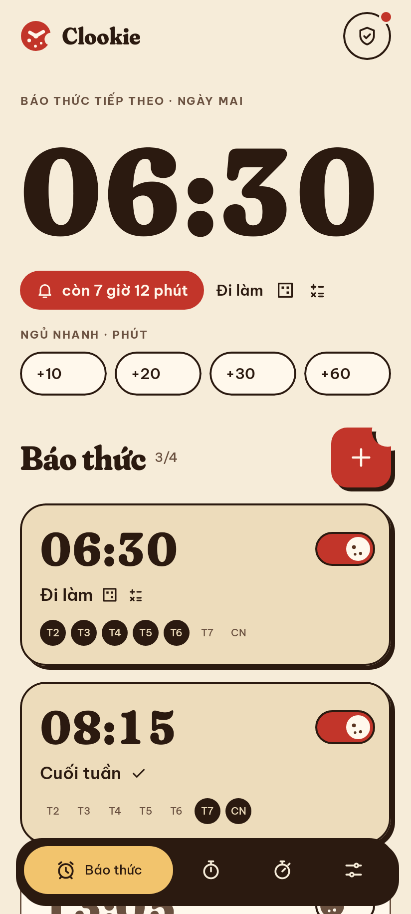
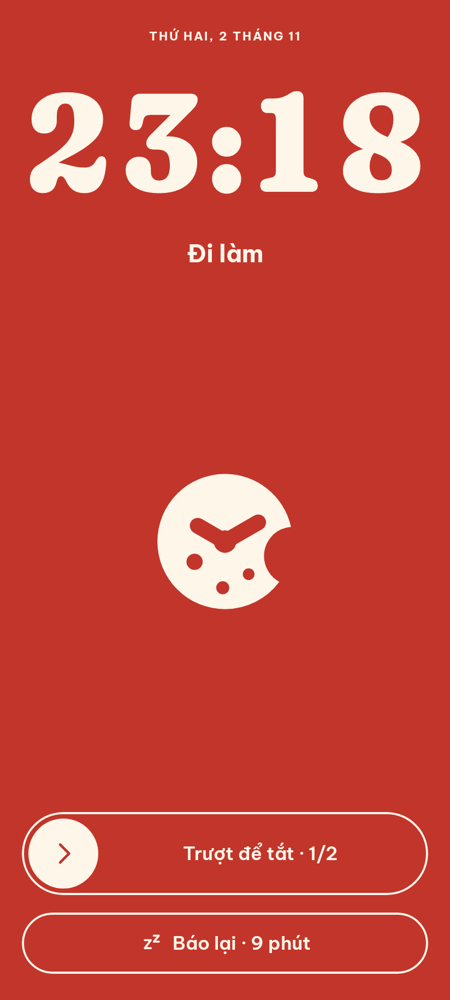
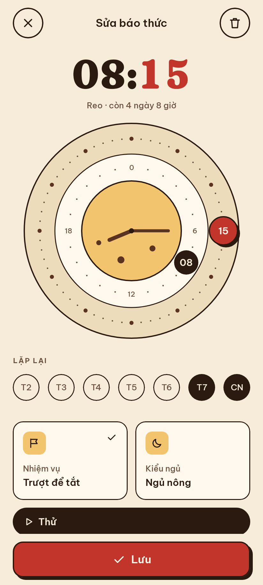
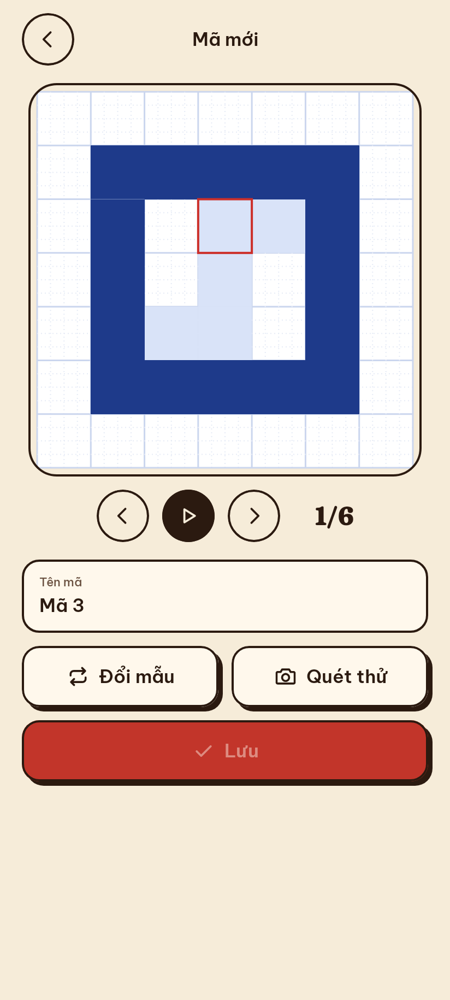
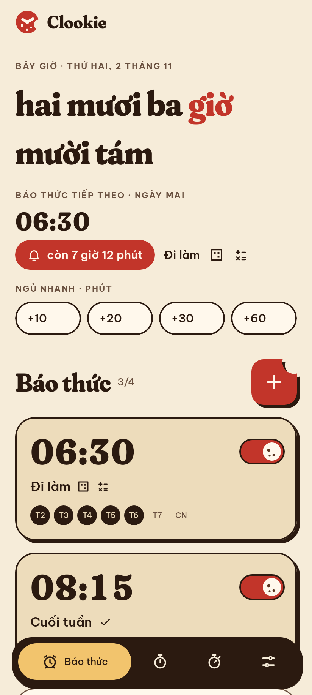

# Clookie

Đồng hồ báo thức Android hình bánh quy: đẹp, chắc chắn reo, và bắt bạn dậy hẳn mới tắt được.

  
  
  
  
  

## Tải về

**[Tải Clookie v1.0.0 (APK)](https://github.com/harieedawwn/clookie/releases/download/v1.0.0/Clookie-v1.0.0.apk)**
· [Mọi phiên bản](https://github.com/harieedawwn/clookie/releases)

Cần Android 8.0 trở lên. Ứng dụng tự báo khi có bản mới.

## Cài đặt

Clookie không có trên CH Play, nên điện thoại sẽ hỏi trước khi cài file APK.

1. Mở link tải ở trên bằng Chrome trên điện thoại, bấm **Tải xuống**.
   Nếu Chrome cảnh báo "File này có thể gây hại", bấm **Vẫn tải xuống**.
2. Mở thông báo **Đã tải xong** (hoặc ứng dụng **Tệp** → **Tải xuống**) và chạm vào `Clookie-v1.0.0.apk`.
3. Nếu hiện "Không được phép cài ứng dụng không rõ nguồn gốc", bấm **Cài đặt** (Settings)
   → bật **Cho phép từ nguồn này** → bấm quay lại.
   - Xiaomi / Redmi / POCO: có thể phải tắt **Chế độ bảo vệ** hoặc bấm **Tiếp tục cài đặt**.
   - Samsung: **Cài đặt → Ứng dụng → Chrome → Cài đặt ứng dụng không xác định → Cho phép**.
4. Bấm **Cài đặt**. Nếu Play Protect hỏi, bấm **Thêm chi tiết → Vẫn cài đặt**.
5. Mở Clookie, bấm **Cấp tất cả** và bật từng quyền trong danh sách **Bắt buộc**.
   Quyền **Hiện trên ứng dụng khác** và **Hiện trên màn hình khoá** giúp màn hình báo thức
   luôn bật lên, kể cả khi bạn đang dùng điện thoại.

Cập nhật bản mới: cài đè lên bản cũ, báo thức và mã đã lưu vẫn giữ nguyên.
